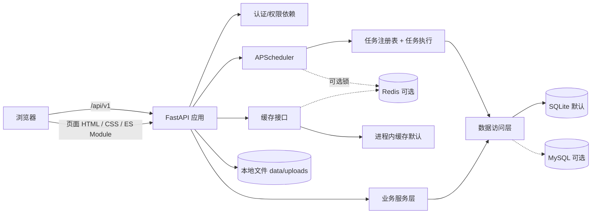
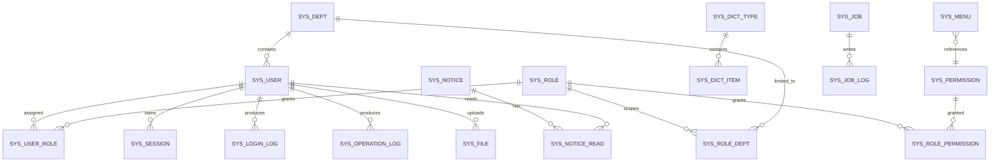

# Fast CMS 管理后台 · 开发计划（v1.0）

| 项目 | 内容 |
|---|---|
| 文档类型 | 总体开发计划 / 实施基线 |
| 版本 | v1.0 |
| 编制日期 | 2026-10-20 |
| 输入 | 《管理后台脚手架 · 竞品调研卷 v2》《管理后台脚手架 · 自研方案卷 v2》 |
| 已确认选型 | Python + FastAPI；Jinja2 直出 HTML + 原生 ES Module；完整版功能范围 |
| 首版形态 | 单仓、单实例、单租户、模块化单体 |
| 默认运行依赖 | Python + SQLite；不启动 MySQL、不启动 Redis |
| 可选依赖 | MySQL 8.x、Redis 7+ |

> **变更说明（前端形态）**：本文立项时按 React + Umi Max + Ant Design Pro 编写，该方案**已被取代**。
> 当前前端由 FastAPI 用 Jinja2 直接渲染 HTML + 原生 ES Module，模板与静态资源位于 `backend/app/web/`，
> 不再有 Node.js / pnpm / 构建产物 / 独立前端进程，`web/` 目录已删除。第 3.2、5、8、10.2、12、13 节已按现状改写；
> 其余章节（功能范围、后端设计、数据模型、权限、调度）仍然有效。
> 前端细节以 [README](../README.md)、[部署与升级](部署与升级.md)、[主题模板](主题模板.md) 为准。

---

## 0. 结论摘要

本项目建设一个**可直接启动、低资源占用的 Python 管理后台基座**，不是复刻调研文档中 137–172 人月的完整企业平台。

调研文档的关键原则会保留：

- 权限码 `{module}:{resource}:{action}` 作为菜单、路由、按钮、接口的共同事实源；
- OpenAPI 作为前后端唯一接口契约；
- 模块化单体优先，插件、多语言、多租户、低代码等能力不进入首版；
- 数据库方言差异通过可移植模型和 CI 矩阵控制，不在业务代码里散落 `if db == ...`；
- 定时任务定义入库、执行有日志、单调度器实例、默认不依赖 Redis；
- 一条命令完成 SQLite 初始化并启动，MySQL、Redis 只在显式开启时连接。

交付节奏：

- **第 5 周末**：标准版可用（登录、RBAC、系统基础、日志、定时任务）；
- **第 10 周末**：完整版可交付（增加文件、公告、在线用户、服务器监控、代码生成器、MySQL/Redis 验证、E2E 与容器化）。

人日估算约 **76 PD**，按 1 名后端 + 1 名前端 + 0.5 名 QA/DevOps 计算，约 10 周；单人顺序实施约 16–18 周。估算包含自测，不包含视觉设计、英文翻译和额外业务模块。

三个最高优先级风险：

1. **前端零构建的边界**：Jinja2 宏 + 原生 ES Module 省掉了工具链，但也意味着没有类型检查和打包优化。防线是 `scripts/check_contract.py` 的 DOM id 与页面外壳校验，以及 `tests/integration/test_web_mount.py` 的资源隔离断言。
2. **SQLite 写并发与调度器重复执行**：SQLite 默认一写多读，调度器必须单实例；多 API worker 场景必须切换到 MySQL 或启用独立的调度进程。
3. **完整版范围膨胀**：代码生成器、数据权限和监控模块最容易无限扩张。本计划为每一项定义明确的“首版能力上限”。

---

## 1. 项目目标与边界

### 1.1 目标

#### 产品目标

提供一个开箱即用的后台管理基座：

- 首次启动仅需 Python 环境与一个空目录，默认使用 SQLite；
- 登录后即可完成用户、角色、菜单、部门、权限、字典、参数、公告、文件、日志、定时任务的管理；
- 拥有企业后台常见的安全与审计能力：登录失败锁定、会话撤销、操作审计、数据脱敏、权限双层校验；
- 后续业务模块可按固定“模块接入配方”增加，不需要修改框架核心；
- 可在单容器、低内存服务器上运行，也可切换到 MySQL 并通过多个 API worker 横向扩展；
- 前后端接口由 OpenAPI 生成，避免手写两套类型。

#### 工程目标

- 单仓开发；前后端同版本发布；
- 默认路径零外部服务；MySQL、Redis 均通过环境变量开启；
- 默认单进程，空闲内存目标 ≤ 180 MB；
- 核心权限与任务链路具备集成测试和 E2E 测试；
- 升级、备份、恢复有明确命令，不依赖手工改库；
- 所有受保护接口都有权限码，并在 CI 中检查覆盖率。

### 1.2 首版明确不做

以下能力在调研文档中属于更大的企业平台，本首版明确不实现：

- 多租户、`tenant_id` 行级隔离、租户套餐与配额；
- 多语言后端、Go/Java 第二实现；
- 运行时插件安装、卸载、热插拔、插件市场；
- 低代码页面、工作流、BPM、报表、大屏；
- 微前端、qiankun、Module Federation；
- 移动端 H5、小程序；
- SSO/OIDC/LDAP、短信、邮件、支付；
- Celery、RabbitMQ、Kafka 等消息队列；
- S3/OSS 默认存储（保留存储接口，首版只实现本地磁盘）；
- 岗位管理、导入导出中心、代码生成器的高级关系建模；
- 英文界面；首版仅中文，保留 i18n 框架位置。

> 这些内容不在首版代码中预留半成品抽象。数据库表、API、前端页面都不为“未来可能的多租户/插件”预先加无意义字段或空实现。

### 1.3 验收定义

完整版必须同时满足：

1. 在仅有 Python 3.12 的干净机器上执行 `make setup && make dev`（或等价命令）后，可直接用 SQLite 启动；
2. 启动日志中不出现 MySQL、Redis 连接尝试（未开启时）；
3. 用初始管理员登录后可完成一次完整流程：建部门 → 建角色 → 配菜单/按钮权限 → 建用户 → 用新用户登录验证菜单与接口权限；
4. 非授权用户直接调用受保护 API 返回 403，前端隐藏菜单不作为唯一保护；
5. 定时任务支持新建、暂停、恢复、立即执行、查看日志；重启后任务定义与下一次执行时间不丢；
6. 可以在不启动 Redis 的情况下完成登录、权限校验、定时任务、文件上传与公告阅读；
7. 开启 MySQL 后，同一套迁移与核心 API 集成测试通过；
8. 开启 Redis 后，缓存与分布式锁路径可用；Redis 不可用时，若显式启用则启动失败并给出明确原因；
9. 前端生产构建可通过，首屏资源预算达标；
10. Docker 单容器 + SQLite 卷可启动；可选 Compose profile 能启动 MySQL、Redis、独立调度器；
11. 备份与恢复命令可用，升级脚本在 SQLite 与 MySQL 上均可重复执行；
12. CI 中后端测试、前端类型检查/构建、OpenAPI 契约检查、权限覆盖率检查全绿。

---

## 2. 已锁定技术决策

| # | 决策 | 结论 | 理由 |
|---:|---|---|---|
| 1 | 前端形态 | 后端 Jinja2 直出 HTML + 原生 ES Module，组件宏复用，无构建步骤 | 单一进程交付，无需 Node 工具链；模板改动即生效 |
| 2 | 前台/后台隔离 | 三套外壳（`admin` / `portal` / `blank`）各自加载自己的样式与脚本 | 前台不背后台样式，公共页不背导航，由脚本校验强制 |
| 3 | 后端框架 | FastAPI + Pydantic v2 + SQLAlchemy 2 async | 原生 OpenAPI、异步、类型清晰、依赖较少 |
| 4 | 默认数据库 | SQLite（`aiosqlite`），数据文件位于 `data/` | 零外部依赖启动；单机管理后台足够 |
| 5 | 可选数据库 | MySQL 8.x（`aiomysql`） | 多写入、多 worker、正式生产推荐 |
| 6 | 缓存/锁 | Redis 可选，默认关闭；内存实现兜底，但**显式启用后连接失败即启动失败** | 避免“以为用了 Redis 实际静默降级”的隐患 |
| 7 | 调度器 | APScheduler 3.11 + 任务定义入库 + MemoryJobStore | 任务可持久化、无额外中间件；启动时从数据库重建任务 |
| 8 | 调度模式 | `embedded` / `standalone` / `disabled` | 单机默认 embedded；多 worker 时 API 关闭调度，单独运行调度进程 |
| 9 | 认证 | JWT access token（内存）+ 轮换 refresh token（HttpOnly Cookie）+ 数据库会话 | 可撤销、可踢下线、刷新令牌可轮换复用检测；不依赖 Redis |
| 10 | 接口契约 | REST + OpenAPI 3.1 + 统一 envelope + `x-permission` | 与调研文档的“契约优先”一致；前端调用点由 `check_api_coverage.py` 与契约双向校验 |
| 11 | 权限模型 | 用户-角色-权限码 + 部门数据范围；权限码独立注册表 | 菜单、按钮、接口共用同一权限码；避免前端隐藏即安全 |
| 12 | 租户 | 首版单租户 | 不在早期引入多租户上下文与数据隔离复杂度 |
| 13 | 文件存储 | 本地磁盘 + 数据库元数据；`StorageBackend` 接口 | 默认零外部依赖；后续可加 S3/OSS |
| 14 | 代码生成 | Jinja2 模板；预览 + 下载 zip + CLI 写入 `generated/`；不覆盖现有文件 | 控制风险，保证可审计和可回滚 |
| 15 | 部署 | 单容器（FastAPI 托管前端 dist）+ SQLite 卷；可选 Nginx/MySQL/Redis | 资源少、部署面小；高并发再拆 |
| 16 | 架构风格 | 模块化单体，按业务域分包 | 比微服务更符合首版规模；保留模块接入规范 |
| 17 | 不使用 | 不直接使用 FastApiAdmin 源码；不引入 starlette-admin 作为第二套后台 | 避免两套用户/权限/菜单模型；竞品只作能力清单参考 |

### 2.1 对调研文档的刻意偏离

| 调研文档建议 | 本项目取舍 | 原因 |
|---|---|---|
| Vue 3 / React 等 SPA 方案 | 改为 Jinja2 直出 HTML + 原生 ES Module | 去掉 Node 工具链与独立前端部署；仍坚持“只维护一套前端” |
| SQLite 列入第三档 | SQLite 作为首版默认，MySQL 作为生产扩展 | 目标是零依赖启动；同时明确 SQLite 的并发限制并做 MySQL CI 验证 |
| Python 仅做轻量适配 | Python 作为本项目主实现 | 本项目就是以 FastAPI 为底座，不承担多语言平台职责 |
| 复杂的插件能力包 | 仅保留代码级模块接入配方 | 首版不实现运行时插件，避免生命周期与数据所有权复杂度 |
| 低代码/微前端 | 不实现 | 与“低资源、可维护、快速交付”目标冲突 |

---

## 3. 技术栈与版本

### 3.1 后端

| 组件 | 版本基线 | 用途 |
|---|---|---|
| Python | 3.12.x（CI 可加 3.13） | 运行时 |
| FastAPI | 0.150.x | Web 框架、OpenAPI |
| Uvicorn | 0.54.x | ASGI 服务器 |
| Pydantic / pydantic-settings | 2.14.x / 2.16.x | 数据校验、配置 |
| SQLAlchemy | 2.1.x（async） | ORM、查询、事务 |
| Alembic | 1.20.x | 迁移，SQLite 使用 batch 模式 |
| aiosqlite | 0.22.x | 默认 SQLite 异步驱动 |
| aiomysql | 0.3.x | 可选 MySQL 异步驱动 |
| APScheduler | 3.11.x | 定时任务 |
| PyJWT | 2.15.x | 访问令牌 |
| argon2-cffi | 25.1.x | 密码哈希，Argon2id |
| redis-py | 8.1.x | 可选缓存/限流/调度锁 |
| psutil | 7.2.x | 服务器监控 |
| Jinja2 | 3.x | 代码生成模板 |
| filetype | 最新稳定版 | 上传文件类型嗅探 |
| pytest / pytest-asyncio / httpx | 9.x / 1.x / 0.28.x | 测试 |
| ruff | 0.17.x | Lint + 格式化 |
| mypy | 最新稳定版 | 关键模块类型检查（Pydantic/SQLAlchemy 插件） |

依赖策略：

- SQLite、MySQL、Redis 驱动均放入基础安装，避免切换数据库时还要改安装命令；**安装不等于连接**，默认不会加载或连接 MySQL/Redis；
- 不使用 Celery、Kafka、Elasticsearch；
- 不使用 passlib（与新版 bcrypt/Argon2 组合存在兼容噪音），直接使用 `argon2-cffi`；
- 不使用 `fastapi-cache` 等额外缓存框架，缓存接口保持小而可控。

### 3.2 前端

前端不做独立工程、不做构建，全部由 FastAPI 直出。

| 组件 | 版本基线 | 说明 |
|---|---|---|
| Jinja2 | 随 FastAPI 提供 | 服务端模板渲染 |
| 原生 ES Module | 浏览器内置 | 无打包、无转译，`<script type="module">` 直接加载 |
| 原生 CSS | 浏览器内置 | CSS 变量做设计令牌，无预处理器 |
| 内联 SVG | — | 图标集写在 `icons.js` 与 `components/ui.html` 里，不引字体/图床 |
| Playwright | 最新稳定版 | 仅用于本地真机自检（`.scratch/`），不进运行时依赖 |

前端分层（详见 README「前端分层」）：

- **组件层** `components/ui.html`（Jinja 宏）+ `css/base.css`：按钮、表单、表格、弹层、分页等通用件；
- **骨架层** `layouts/{admin,portal,blank}.html` + `js/shell/{admin,auth,portal}.js`：后台外壳、前台外壳、公共页外壳，各自只加载自己的样式表；
- **页面层** `pages/**` + `js/pages/*.js`：只填内容块，行为按 `page_key` 动态 `import()`。

前台（`PORTAL_BASE`，默认 `/front`）与后台（`ADMIN_BASE`，默认 `/admin`）在模板、样式、脚本三处物理隔离，互不加载对方资源。

### 3.3 版本锁定的工程要求

- 后端使用 `pyproject.toml`，依赖版本区间写在 `backend/pyproject.toml` 并锁在安装脚本选定的镜像源上；
- 前端没有依赖清单：没有 `package.json`、没有锁文件、没有 Node 工具链；
- 前后端一致性由脚本静态校验，而不是靠类型系统：`scripts/check_contract.py`（OpenAPI 契约 + 权限码 + 页面外壳 + DOM id）、`scripts/check_api_coverage.py --strict`（端点与前端调用点对齐）；
- 样式与模板改动后无需重新构建，重启进程即可生效。

---

## 4. 总体架构

### 4.1 运行架构



运行时说明：

- 浏览器只访问同源地址：页面来自 `ADMIN_BASE` / `PORTAL_BASE`，数据来自 `/api/v1`，同一个进程、同一个端口；
- API 进程内默认启动 APScheduler；多 worker 时改由独立 `fastcms scheduler` 进程执行；
- Redis 只承担缓存、限流计数、可选的调度锁；认证、会话、任务定义、任务日志全部以数据库为准；
- SQLite 数据、上传文件、自动生成的密钥统一放在 `data/`，便于打包与备份。

### 4.2 后端分层与依赖规则

```text
Router（HTTP、权限依赖、参数解析）
  → Service（业务规则、事务边界、审计）
    → Repository（SQLAlchemy 查询）
      → Model（ORM 映射）

Schema（Pydantic 输入/输出）与 Router 同模块
Core（配置、安全、异常、缓存、分页、日志）被所有模块使用
Jobs 只调用 Service，不直接依赖 Router
```

强制规则：

- Router 不写 SQL，不直接操作 ORM Session；
- Service 不接收 FastAPI 的 `Request`/`Response` 对象；
- 跨模块调用只通过对方 Service 的公开方法，禁止直接查对方表；
- 模块之间不共享可变全局状态；
- 任务、CLI、API 复用同一 Service，避免三套业务逻辑；
- 所有写操作在 Service 内完成事务与审计字段填充。

### 4.3 三种运行模式

| 模式 | 用途 | 组成 | 约束 |
|---|---|---|---|
| 开发模式 | 本机开发 | Uvicorn 单进程（含页面）+ SQLite，`--reload` | 调度器 embedded；热重载会重复启动调度器，靠 `SCHEDULER_MODE` 规避 |
| 单机生产 | 小客户/内网 | 单容器 + SQLite + 1 个 Uvicorn worker | 调度器 embedded；SQLite 文件置于持久卷 |
| 扩展模式 | 多 worker/多实例 | 多个 API worker + 独立 scheduler 进程 + MySQL；Redis 可选 | API 设置 `SCHEDULER_MODE=disabled`；仅一个 scheduler 实例或使用 Redis 锁 |

默认参数：

- `APP_WORKERS=1`
- `SCHEDULER_MODE=embedded`
- `REDIS_ENABLED=false`
- `DB_URL=sqlite+aiosqlite:///./data/fastcms.db`

### 4.4 资源模型

- 默认单进程；APScheduler 使用 AsyncIOScheduler，与 API 共用一个事件循环；
- SQLite 启用 WAL、`busy_timeout`、外键约束；
- 所有长耗时逻辑不得占用数据库事务等待外部 I/O；
- 默认只运行一个调度器；任务并发默认 `max_instances=1`；
- 上传文件流式写入磁盘，不整块读入内存；
- 页面由后端 Jinja2 直接渲染（SSR），浏览器只加载同源 CSS 与 ES Module，没有构建产物，也没有独立的前端进程。

---

## 5. 工程结构

```text
fast_cms/
├── backend/
│   ├── app/
│   │   ├── main.py                 # FastAPI 工厂、生命周期、静态资源
│   │   ├── cli.py                  # init / seed / sync-rbac / gen / backup / restore
│   │   ├── core/
│   │   │   ├── config.py           # pydantic-settings，环境变量
│   │   │   ├── security.py         # Argon2、JWT、token 生成
│   │   │   ├── authz.py            # require_permission、超级管理员、权限依赖
│   │   │   ├── errors.py           # 业务异常、错误码、异常处理
│   │   │   ├── pagination.py       # 分页查询与响应
│   │   │   ├── middleware.py       # request_id、日志、安全响应头
│   │   │   ├── cache.py            # Cache 协议、Memory/Redis 实现
│   │   │   ├── logging.py          # 结构化日志与脱敏
│   │   │   └── time.py             # UTC 时间工具
│   │   ├── db/
│   │   │   ├── base.py             # Declarative Base、命名约定
│   │   │   ├── session.py          # async engine/session
│   │   │   └── types.py            # UTCDateTime 等可移植类型
│   │   ├── modules/
│   │   │   ├── auth/               # 登录、刷新、登出、当前用户、会话
│   │   │   ├── system/             # 用户、角色、菜单、部门、权限注册表
│   │   │   ├── config/             # 字典、系统参数
│   │   │   ├── audit/              # 登录日志、操作日志
│   │   │   ├── dashboard/          # 首页统计
│   │   │   ├── schedule/           # 定时任务与日志
│   │   │   ├── content/            # 公告、文件
│   │   │   └── monitor/            # 在线用户、服务器信息
│   │   ├── codegen/                # 代码生成器（元数据、模板、打包）
│   │   ├── jobs/
│   │   │   ├── registry.py         # 任务注册表与参数 schema
│   │   │   ├── runner.py           # 超时、日志、分布式锁
│   │   │   └── builtin.py          # 清理会话、清理日志等内置任务
│   │   ├── bootstrap/
│   │   │   ├── permissions.py      # 权限码声明
│   │   │   ├── menus.py            # 菜单基线
│   │   │   └── seed.py             # 初始化管理员、内置角色、字典、参数
│   │   └── templates/codegen/      # Jinja2 模板
│   ├── migrations/                 # Alembic
│   ├── tests/
│   │   ├── unit/
│   │   ├── integration/
│   │   └── conftest.py
│   ├── pyproject.toml
│   └── alembic.ini
├── docs/
│   ├── 开发计划.md
│   ├── 认证与权限.md
│   ├── 定时任务.md
│   ├── 代码生成器.md
│   ├── 部署与升级.md
│   ├── 主题模板.md
│   ├── 消息通知.md
│   └── API规范.md
├── docker/
│   ├── Dockerfile
│   ├── entrypoint.sh
│   └── compose.yml
├── scripts/
├── data/                           # 运行时生成，不提交
├── .env.example
├── Makefile
├── README.md
└── openapi.json                    # 由后端导出，供契约校验
```

前端不单独成目录，随后端一起分发（`backend/app/web/`）：

```text
backend/app/web/
├── templates/
│   ├── base.html                   # 文档骨架：base.css + 主题预置脚本 + app.js
│   ├── components/ui.html          # 组件宏库：page_head/card/filter_form/data_table/modal/field/icon…
│   ├── layouts/
│   │   ├── admin.html              # 后台外壳（侧边导航 + 顶栏 + 内容区）
│   │   ├── portal.html             # 前台外壳（顶部导航 + 内容 + 页脚）
│   │   └── blank.html              # 公共页外壳（登录、错误页）
│   ├── partials/                   # theme-boot / boot-mask / notice-modal
│   ├── pages/                      # 24 个后台页面，全部 
│   └── portal/home.html            # 前台首页，
└── static/
    ├── css/{base,admin,portal,public}.css   # 令牌与通用件 / 后台 / 前台 / 公共页
    └── js/
        ├── app.js                  # 入口：按 page_key 决定外壳并动态 import 页面脚本
        ├── core.js  ui.js  icons.js
        ├── shell/{admin,auth,portal}.js
        └── pages/*.js              # 每页一个 ES Module
```


---

## 6. 数据模型与权限设计

### 6.1 核心实体关系



### 6.2 数据表清单

| 表 | 用途 | 关键点 |
|---|---|---|
| `sys_user` | 管理员账号 | `username_normalized` 唯一；`is_superuser`；`token_version`；`must_change_password` |
| `sys_role` | 角色 | `code` 唯一；`data_scope`；内置角色不可删除 |
| `sys_permission` | 权限码注册表 | `code` 唯一；只读；记录模块、类型、是否弃用 |
| `sys_menu` | 菜单/按钮/目录 | `type`、`component_key`、`permission_code`、`parent_id` |
| `sys_dept` | 部门树 | `ancestors` 路径；禁止循环；删除前校验子节点/用户 |
| `sys_user_role` | 用户-角色 | 联合主键；删除角色前校验 |
| `sys_role_permission` | 角色-权限 | 保存权限码 ID，不保存前端路由字符串 |
| `sys_role_dept` | 自定义数据范围 | 仅 `data_scope=custom` 时使用 |
| `sys_dict_type` / `sys_dict_item` | 字典 | 类型编码唯一；展示值/值分离；可缓存 |
| `sys_config` | 系统参数 | 非敏感、可运行时调整；敏感配置只允许环境变量 |
| `sys_session` | 刷新会话/在线记录 | `refresh_hash`、`expires_at`、`revoked_at`、`last_seen_at` |
| `sys_login_log` | 登录日志 | 成功/失败、IP、UA、失败原因；分页与保留期 |
| `sys_operation_log` | 操作日志 | 路由、动作、结果、耗时、脱敏参数、前后值摘要 |
| `sys_notice` | 公告 | 草稿/发布状态、发布人、发布时间 |
| `sys_notice_read` | 公告已读 | 用户与公告联合唯一 |
| `sys_file` | 文件元数据 | 随机存储名、原始名、MIME、大小、SHA-256、上传人 |
| `sys_job` | 定时任务定义 | `job_type`（registry/python）、处理器或脚本、触发器类型/表达式/状态/超时 |
| `sys_job_template` | 任务模板 | 可复用任务配置，内置模板不可修改 |
| `sys_job_lock` | 执行租约 | `lock_key` 主键、`run_token`、owner、过期时间；跨进程去重 |
| `sys_job_log` | 任务执行日志 | 触发方式、开始/结束、状态、耗时、截断输出、run_token、脚本摘要 |
| `sys_theme` | 主题模板 | 主题配置 JSON、内置标记、排序；内置主题随种子更新 |
| `sys_notify_channel` | IM 通知渠道 | 类型（钉钉/飞书/企业微信/webhook）、地址与密钥按凭证对待（只回显脱敏值）、订阅事件数组、启停状态 |
| `sys_notify_record` | 通知发送记录 | `(channel_id, event, dedupe_key)` 唯一实现入队去重；状态、尝试次数、退避时间、响应码与失败摘要；渠道删除后保留 `channel_name` 快照 |
| `sys_bootstrap` | 基线同步版本 | 记录权限/菜单基线版本，避免重复覆盖 |
| `alembic_version` | 迁移版本 | Alembic 管理 |

删除策略：

- 用户、角色采用硬删除，但必须通过业务保护：
  - 不能删除自己；
  - 不能删除最后一个超级管理员；
  - 不能删除内置角色；
  - 不能删除仍被用户引用的角色；
  - 日志保留 `user_id + username` 快照，不因用户删除而丢审计；
- 部门删除前校验子部门与用户；
- 菜单中挂有权限码的节点不物理删除，改为停用；
- 文件与公告可硬删除；文件删除需同时删除磁盘对象。
- 通知渠道硬删除，历史发送记录保留（`channel_id` 置空、名称与类型已快照），便于审计追溯。

### 6.3 权限模型

#### 权限码规范

统一格式：

```text
{module}:{resource}:{action}
```

示例：

| 权限码 | 含义 |
|---|---|
| `system:user:list` | 查看用户 |
| `system:user:create` | 新建用户 |
| `system:user:reset-password` | 重置密码 |
| `system:role:assign-permission` | 给角色分配权限 |
| `system:dept:delete` | 删除部门 |
| `monitor:login-log:list` | 查看登录日志 |
| `monitor:operation-log:export` | 导出操作日志 |
| `monitor:online:kick` | 强制下线 |
| `monitor:server:read` | 查看服务器信息 |
| `schedule:job:trigger` | 立即执行任务 |
| `tool:file:upload` | 上传文件 |
| `tool:codegen:generate` | 生成代码 |
| `dashboard:view` | 查看仪表盘 |

权限码来源：

1. 代码中的 `bootstrap/permissions.py` 声明基线；
2. 菜单/按钮节点引用权限码；
3. 后端路由通过 `require_permission(code)` 声明；
4. 导出 OpenAPI 时写入 `x-permission`；
5. 前端从契约生成 `permissions.ts` 常量。

超级管理员：

- `sys_user.is_superuser = true` 的用户绕过权限码检查，但仍走登录、会话、审计；
- 只有超级管理员能创建/修改其他超级管理员；
- 内置 `admin` 用户不可删除；
- 普通管理员为角色分配的权限必须是其自身权限的子集；不得通过角色管理提权。

校验原则：

- 菜单隐藏只影响可见性，不代替接口鉴权；
- 后端是最终判定方；前端只负责体验；
- 所有非公开路由都必须有权限声明；
- 未声明权限的受保护路由在 CI 中失败。

#### 角色与数据范围

`sys_role.data_scope` 取值：

| 值 | 含义 | 过滤规则 |
|---|---|---|
| `all` | 全部数据 | 不附加部门过滤 |
| `dept` | 本部门 | `dept_id = 当前用户部门` |
| `dept_and_below` | 本部门及下级 | 使用部门 `ancestors` 路径匹配 |
| `self` | 仅自己 | `user_id = 当前用户` |
| `custom` | 指定部门 | 通过 `sys_role_dept` 关联 |

首版适用范围：

- 用户列表；
- 文件列表；
- 与用户绑定的操作记录（如需要按部门裁剪时）；
- 登录日志与操作日志默认**不按部门裁剪**，只按日志查看权限控制，避免审计数据被数据范围意外遮蔽；若要按部门查看，后续单独设计日志快照字段；
- 公告、字典、配置为全局资源，不参与数据范围。

实现要求：

- 数据范围由统一 `apply_data_scope(stmt, current_user, resource)` 函数生成，禁止各路由手写过滤；
- 用户创建时校验目标部门在操作者数据范围内；
- 超级管理员不受数据范围限制；
- 测试必须覆盖五种数据范围及越权用例。

### 6.4 初始化与基线同步

初始化分两类：

1. **结构初始化**：Alembic 创建表；
2. **数据基线**：`fastcms init` 写入管理员、内置角色、权限、菜单、字典、参数。

基线同步规则：

- `bootstrap` 版本变更时执行幂等 upsert；
- 新增权限/菜单自动加入；
- 被移除的权限码标记为 `deprecated_at`，不物理删除；
- 不覆盖角色已有的自定义权限绑定；
- 内置角色被保护，不允许删除；
- 每次同步输出 diff（新增/弃用/菜单变更），生产环境需要显式 `--apply`；
- CI 校验代码里的权限声明与 OpenAPI 中的 `x-permission` 完全一致。

首次启动安全策略（2026-10 修订：按使用者要求改为固定默认口令，生产环境仍强制覆盖）：

- 默认管理员为 `admin / fast_cms_123`，`INITIAL_ADMIN_PASSWORD` 可覆盖；不再生成一次性随机密码，初始口令不写入日志；
- `APP_ENV=prod|production` 时若仍为默认口令，`init`/启动直接失败并提示设置 `INITIAL_ADMIN_PASSWORD`；
- 仅生产环境的 `admin.must_change_password = true`，登录后强制进入修改密码页，未改密前其他业务接口拒绝访问；本地开发与测试可直接使用默认口令登录；
- `APP_SECRET_KEY` 未提供时自动生成到 `data/.secret`（权限 0600），并提示生产环境改用环境变量；

### 6.5 数据库可移植性规则

SQLite 与 MySQL 必须使用同一套 ORM 和迁移逻辑：

| 主题 | 规则 |
|---|---|
| 主键 | 用户、角色等业务表使用 `Integer` 自增；日志等大表使用 `BigInteger`，SQLite 通过变体映射 |
| 时间 | 统一 UTC 存储；通过自定义 `UTCDateTime` 类型保证跨库读取一致；API 输出 ISO 8601 UTC，前端按本地时区显示 |
| 布尔 | 使用 SQLAlchemy `Boolean`；不使用数据库枚举 |
| 枚举 | 存字符串，由 Pydantic/Service 校验；避免 MySQL ENUM 与 SQLite 差异 |
| JSON | 使用 SQLAlchemy `JSON`；只做整体读写，不依赖 JSON 路径查询 |
| 字符 | 建库字符集 `utf8mb4`；用户名、角色码、权限码等唯一标识默认转小写存储；避免排序规则差异 |
| 索引 | 唯一索引列保持短长度；日志表按时间和用户 ID 建索引 |
| 搜索 | 统一在服务层规范化（如小写）；不依赖数据库默认大小写规则 |
| DDL | 迁移只用 Alembic op；SQLite 使用 `batch_alter_table`；禁止迁移中拼接数据库专属 SQL |
| 事务 | 不长时间持有写事务；SQLite 模式下避免在事务内做外部网络调用 |
| 连接 | SQLite：WAL、外键、busy_timeout=5000、synchronous=NORMAL；MySQL：`pool_pre_ping`，显式连接池大小 |
| 分页 | 统一 offset/limit，最大 page_size=100；不依赖数据库专属分页语法 |
| UPSERT | 首版业务不依赖批量 upsert；如需使用，按方言单独实现并测试 |

迁移策略：

- `alembic upgrade head` 为唯一结构升级入口；
- 应用启动前检查迁移版本，落后时给出明确错误；开发模式可自动迁移，生产默认不允许隐式迁移；
- SQLite 升级前自动备份 `data/fastcms.db` 到 `data/backups/`；
- 不编写不可回滚的 DDL；确实不可回滚时在迁移说明中标注并提供补偿脚本；
- MySQL 与 SQLite 都必须在 CI 中从零执行“建库 → 升级 → 种子 → 冒烟”。

### 6.6 会话与在线状态

`sys_session` 字段与行为：

- `refresh_token_hash`：只存哈希，不存明文；
- `sid`：JWT 中携带的会话 ID；
- `last_seen_at`：前端每 60 秒调用一次心跳接口更新；
- `expires_at`、`revoked_at`；
- 在线判定：`revoked_at IS NULL AND last_seen_at > now - 3 分钟`；
- 刷新令牌轮换：每次刷新生成新令牌，旧令牌立即失效；检测到旧令牌重用则撤销整个会话；
- 修改密码、禁用用户、强制下线会撤销会话；
- 定期任务清理过期会话与过期刷新令牌。

access token 默认 15 分钟，refresh token 默认 7 天；均可在环境变量中调整。

---

## 7. 后端设计

### 7.1 认证流程

1. `POST /api/v1/auth/login`：用户名 + 密码 +（可选）验证码；
2. 校验用户状态、锁定状态、密码；
3. 创建 `sys_session`，签发 access JWT 与 refresh token；
4. refresh token 写入 HttpOnly Cookie（`SameSite=Lax`、HTTPS 下 `Secure`），access token 返回给前端并只保存在内存；
5. 前端请求携带 `Authorization: Bearer <access>`；
6. access 过期时，前端单飞刷新（同一时刻只发一个刷新请求，其余排队）；
7. refresh 失败则清理状态并跳转登录；
8. 登出撤销当前会话并清除 Cookie；
9. 心跳接口更新在线状态。

安全细节（落地实现，2026-10 补充）：

- 登录失败按用户名计数；用户名连续失败 5 次锁定 15 分钟（`AUTH_MAX_FAILED`、`AUTH_LOCK_MINUTES`），失败信息不区分用户不存在/密码错误；
- 未知用户名同样执行一次 Argon2 校验（占位哈希），响应时间一致，避免计时枚举；锁定状态只在密码正确后才以 423 暴露；
- 限流不止登录：登录按 IP（`LOGIN_RATE_LIMIT`/`LOGIN_RATE_WINDOW`），刷新、改密、重置密码、上传、头像、导出、日志清理、代码生成写库由 `ratelimit.py` 的 `RATE_RULES` 按窗口限制，已登录接口以 token `sub` 为计数键，超限返回 429 + `Retry-After`；总开关 `RATE_LIMIT_ENABLED`；
- 客户端 IP 默认只取直连来源，`TRUST_PROXY=true` 才采用 `X-Forwarded-For`，防止伪造头绕过限流并污染审计；
- 密码策略：最少位数取自系统参数 `security.password_min_length`（默认与下限 8），必须同时包含字母和数字、不包含用户名、不命中弱口令黑名单；创建/重置/自助改密/CLI 共用同一校验，策略经公开参数下发给前端表单；
- Cookie `Secure` 由环境推导（`dev/development/local/test/pytest` 关闭，其余开启），`AUTH_COOKIE_SECURE` 可显式覆盖；
- 重置密码后撤销该用户全部会话；修改密码需要当前密码，成功后递增 `token_version` 并撤销其他会话；
- 权限与数据范围每个请求都从数据库重新装载，因此调整角色/权限/部门无需撤销会话，下一次请求即生效；
- JWT 签名密钥来自 `APP_SECRET_KEY`；
- 拒绝 `alg=none`，固定算法与 issuer；
- 关闭用户后，后续请求校验用户状态并拒绝。

公开接口：

- 登录、刷新、公开配置（标题/Logo/密码策略提示）、健康检查；
- 其余接口一律需要认证。

### 7.2 API 规范

基础路径：`/api/v1`。

统一成功响应：

```json
{
  "code": "OK",
  "message": "success",
  "data": {},
  "request_id": "01J..."
}
```

统一分页数据：

```json
{
  "items": [],
  "page": 1,
  "page_size": 20,
  "total": 0
}
```

统一错误响应：

```json
{
  "code": "AUTH_INVALID_CREDENTIALS",
  "message": "用户名或密码错误",
  "details": null,
  "request_id": "01J..."
}
```

约定：

- HTTP 状态码表达语义（401/403/404/409/422/429/500），业务码表达具体原因；
- 业务码为稳定字符串，前端可映射文案；禁止用中文消息做判断；
- 所有响应带 `X-Request-ID`，日志中记录同一 ID；
- 422 校验错误转换为统一 `details` 数组；
- 列表排序字段必须走白名单，禁止直接把请求字段拼进 `order_by`；
- 分页上限 100；导出上限 10,000 行并单独审计；
- 时间输出 ISO 8601 UTC（`...Z`），前端用 `Intl.DateTimeFormat` 按 `TZ` 转本地；
- 文件下载不包 envelope，直接流式返回。

OpenAPI 扩展：

- 受保护路由声明 `openapi_extra={"x-permission": "system:user:list"}`，或通过自定义 APIRoute 自动收集权限依赖；
- 错误响应注明业务码；
- CI 校验 `operationId` 唯一、权限码存在、所有受保护路由都有 `x-permission`。

### 7.3 模块与接口清单

| 模块 | 主要接口 | 权限码前缀 |
|---|---|---|
| 认证 | 登录、刷新、登出、当前用户、心跳、修改密码、会话列表/撤销 | `auth:*`, `account:*` |
| 用户 | 列表、详情、创建、更新、删除、启停、重置密码、分配角色 | `system:user:*` |
| 角色 | 列表、详情、创建、更新、删除、分配权限、设置数据范围 | `system:role:*` |
| 菜单 | 树、创建、更新、删除/停用 | `system:menu:*` |
| 部门 | 树、创建、更新、删除 | `system:dept:*` |
| 权限注册表 | 只读列表、按模块分组 | `system:permission:list` |
| 字典 | 类型/字典项 CRUD、按类型读取 | `system:dict:*` |
| 参数 | 列表、创建、更新、删除、公开参数读取 | `system:config:*` |
| 公告 | 管理端 CRUD/发布；用户端已发布列表、已读、未读数 | `system:notice:*` |
| 文件 | 上传、列表、下载、删除、预览元数据 | `tool:file:*` |
| 登录日志 | 列表、详情、清理、导出 | `monitor:login-log:*` |
| 操作日志 | 列表、详情、清理、导出 | `monitor:operation-log:*` |
| 在线用户 | 列表、强制下线 | `monitor:online:*` |
| 服务器监控 | CPU/内存/磁盘/运行信息 | `monitor:server:read` |
| 定时任务 | 列表、创建、更新、删除、暂停、恢复、立即执行、执行日志 | `schedule:job:*` |
| 消息通知 | 渠道 CRUD/测试、发送记录列表与详情、手工重试、记录清理 | `notify:channel:*`, `notify:record:*` |
| 仪表盘 | 汇总统计、近 7 天登录趋势、任务失败数 | `dashboard:view` |
| 代码生成 | 表列表、列元数据、预览、下载、写入 generated | `tool:codegen:*` |
| 元信息 | 应用版本、数据库方言、迁移版本、健康检查 | 公开/登录 |

接口设计注意：

- 用户列表支持 `keyword`（用户名/昵称/手机号）、`dept_id`（含下级）、`status`、角色筛选；
- 角色分配权限使用权限码集合，不直接传路由路径；
- 菜单树与权限树分离：菜单负责显示结构，权限负责授权；
- 公告的“用户端”接口只返回已发布内容，不受管理端权限影响；
- 文件下载必须校验登录与权限，不能直接暴露上传目录；
- 通知渠道的地址与密钥只写不回显，读取接口返回脱敏地址与 `has_secret`，更新时留空表示保留原值。

### 7.4 定时任务设计

#### 数据与执行职责

- `sys_job` 是任务定义的**唯一事实源**；
- APScheduler 只作为执行器，使用 MemoryJobStore，启动时按数据库定义重建任务；
- 任务支持两种类型：
  - `registry`：任务函数来自 `jobs/registry.py` 中注册的 code，参数由 Pydantic schema 校验；
  - `python`：脚本存储在数据库中，在隔离子进程执行，受独立权限 `schedule:job:code` 与 `SCHEDULER_PYTHON_ENABLED` 开关约束；
- 任务模板存储在 `sys_job_template`，仅用于创建任务时预填；
- 执行租约存储在 `sys_job_lock`，按 `job:{id}` 维度互斥；任务编码可复用，不参与互斥；
- 任务日志写入 `sys_job_log`，与任务定义解耦；
- 调度器重启后从数据库恢复任务与下次执行时间。

#### 任务字段

- 名称、code、描述；
- 触发器：`cron` / `interval` / `date`；
- cron 表达式与时区（默认应用时区，存储时换算为 UTC）；
- `interval_seconds` 或 `run_at`；
- 参数 JSON；
- 状态：启用/暂停；
- 超时秒数；
- 失败策略：首版仅记录失败，不自动重试；后续再评估重试次数；
- 最近执行时间、下次执行时间、最近状态。

#### 执行语义

- `max_instances=1`，同一任务不并发；
- `coalesce=true`，错过的多次执行合并为一次；
- `misfire_grace_time` 可配置；
- 超时通过 `asyncio.wait_for` 实现；任务需为可取消的异步函数；
- 执行前申请数据库租约，TTL 大于任务超时并在执行期间续租；获取失败写入 `skipped` 日志；
- 任务输出截断到 32 KB，错误堆栈截断保存；
- 任务执行开始即写入“running”日志；进程重启时只把没有活跃租约的 running 标记为“interrupted”；
- 立即执行不改变周期计划，只新增一条手动触发的执行记录；
- Python 脚本在独立子进程中执行，超时/取消时清理整个进程树；
- 所有任务操作写入操作日志。

#### 调度模式与多实例

| 模式 | 行为 |
|---|---|
| `embedded` | FastAPI 启动时创建 AsyncIOScheduler；仅允许单 worker |
| `standalone` | API 不创建调度器；运行 `fastcms scheduler` 独立进程 |
| `disabled` | 完全不创建调度器（测试、只读部署） |

- 默认单 worker；若检测到 `APP_WORKERS > 1` 且模式为 embedded，启动直接失败并提示改用 standalone/disabled；
- 多 scheduler 实例共享同一数据库时，由 `sys_job_lock` 数据库租约保证同一任务/编码不会并发执行，无需 Redis；
- Redis 锁不再作为调度去重的必需项，Redis 仍可用于缓存与限流；
- 不把 Celery 作为默认方案，保持中间件最小化。

#### 内置任务

- 清理过期会话；
- 清理超过保留期的登录日志/操作日志/任务日志；
- 清理未被引用的临时上传文件；
- 示例心跳任务（仅用于演示和测试，可禁用）。

#### 任务管理界面能力

- 启用/暂停；
- 编辑 cron/interval/date 参数；
- 预览未来 5 次执行时间；
- 立即执行；
- 查看最近执行日志与错误摘要；
- 注册任务只能选择已注册 code；Python 任务提供脚本编辑与语法校验；
- 新建任务支持从任务模板预填，模板支持 CRUD 与复制；
- 内置任务不可删除，只能暂停。

### 7.5 MySQL 与 Redis 可选实现

#### MySQL

- 通过 `DB_URL` 切换为 `mysql+aiomysql://...`；
- 连接池默认 size 10、overflow 5，可配置；
- 迁移脚本不写 MySQL 专属语法；CI 使用 MySQL 8 容器执行完整迁移与核心 API 冒烟；
- 部署多 worker 时推荐 MySQL，禁止多 worker + SQLite。

#### Redis

- `REDIS_ENABLED=false` 时完全走内存实现，不导入 Redis 客户端连接；
- 启用后用于：
  - 通用缓存（字典、系统参数、公开配置）；
  - 登录/接口限流计数；
  - 多调度器实例锁；
  - 可选的在线状态加速（首版仍以数据库为事实源）；
- 明确启用但无法连接时：启动失败，输出连接地址与排查提示；不允许静默降级；
- 所有 key 加 `fastcms:` 前缀；
- 缓存失效策略：写操作后主动删除；对权限/会话等正确性敏感数据首版不做缓存。

### 7.6 日志、文件、公告、监控、代码生成

#### 登录日志与操作日志

登录日志：

- 每次登录尝试都写入，包括用户不存在、密码错误、账号锁定、成功；
- 字段包含用户名输入、用户 ID（可空）、结果、失败原因码、IP、User-Agent、时间；
- 密码、令牌、Cookie 永不写入；
- 登录日志不按数据范围过滤，只按 `monitor:login-log:*` 权限控制。

操作日志：

- 所有写操作（POST/PUT/PATCH/DELETE）以及任务触发、强制下线、导出等敏感操作都写入；
- 使用统一的审计辅助方法，记录：
  - 操作者、模块、动作、路由、HTTP 方法；
  - 目标对象类型与 ID；
  - 结果、HTTP 状态、耗时、request_id；
  - 脱敏并截断后的请求参数；
  - 关键资源（用户、角色、菜单、参数、权限分配）的前后值摘要；
- 密码、令牌、Cookie、密钥、上传文件内容只记录“已修改”标记，不记录原值；
- 日志写入与主业务事务解耦：业务成功后异步写入独立会话；写入失败时回退到应用错误日志并记录 request_id，不能导致业务请求失败；
- 操作日志查看、清理、导出均需要独立权限；导出最多 10,000 行并额外写入一条“导出操作”审计；
- 作业执行使用系统身份，操作日志记录 `actor=scheduler`；
- 后台任务按保留期清理，清理动作本身也写审计。

#### 文件管理

- 默认存储在 `data/uploads/YYYY/MM/<uuid>.<ext>`；
- 数据库保存原始文件名、MIME、大小、SHA-256、上传人、存储路径；
- 上传限制：
  - 最大 20 MB（可配置）；
  - 扩展名 + MIME 双重校验，使用 `filetype` 嗅探；
  - 禁止 SVG 等可执行脚本类型，或按配置限制；
  - 随机文件名，禁止使用用户提供的路径；
- 下载通过鉴权接口流式返回，`Content-Disposition` 文件名转义；
- 图片预览使用鉴权请求转 Blob URL，不直接暴露服务器路径；
- 删除文件时同时删除磁盘对象；失败时标记元数据并记录错误；
- 预留 `StorageBackend` 接口，但首版只实现本地磁盘。

#### 公告

- 管理端：草稿、发布、撤回、置顶、删除；
- 用户端：已发布公告列表、详情、标记已读、未读数；
- 顶部导航铃铛展示未读数，轮询间隔 60 秒；
- 首版不发送邮件/短信/WebSocket。

#### 在线用户

- 数据来自 `sys_session` 与心跳；
- 列表展示用户、IP、UA、登录时间、最后活跃时间；
- 支持强制下线：撤销会话并使 access token 失效（通过 token_version 或会话校验）；
- 刷新频率 30 秒，仅管理员可见。

#### 服务器监控

- 使用 `psutil` 采集 CPU、内存、磁盘、负载、网络、运行时长；
- 展示应用版本、Python 版本、数据库方言、迁移版本；
- 不返回环境变量、密钥、连接串；
- 仅 `monitor:server:read` 权限访问。

#### 代码生成器

首版范围（明确上限）：

- 输入：数据库表名或表选择；
- 支持：单表、单主键、标量字段的 CRUD；
- 生成：
  - SQLAlchemy Model；
  - Pydantic Schema；
  - Repository + Service + Router；
  - 权限码与菜单接入说明（不自动写数据库）；
  - Backend 测试骨架；
  - 前端 TSX 页面骨架（ProTable + ModalForm）；
  - 生成清单与文件哈希；
- 不支持：多表关系、复合主键、工作流、复杂联动、自动迁移执行；
- 安全：
  - 只读取表元数据，不执行用户输入 SQL；
  - 模块名/类名/路由段做正则校验；
  - 预览与下载 zip；CLI `--write` 只能写入 `backend/generated/`，禁止覆盖已有文件；
  - 生成结果带 `# generated` 标记与生成器版本；
- 验收：用内置示例表生成后，后端模块可导入、测试通过；前端文件可编译。

### 7.7 安全清单

| 项目 | 措施 |
|---|---|
| 密码 | Argon2id；强度策略；重置失效会话 |
| JWT | 短有效期；固定算法；issuer/audience 校验；密钥不入库 |
| 刷新令牌 | 随机 256-bit；哈希存储；轮换；重用检测 |
| 登录 | 失败计数、锁定、限流；错误信息不泄漏账号是否存在；未知用户也执行哈希校验，锁定仅在密码正确后暴露 |
| 接口限流 | `RATE_RULES` 覆盖刷新、改密、重置密码、上传、导出、日志清理、代码生成写库；429 + `Retry-After`；已登录接口按 token `sub` 计数 |
| 代理信任 | 默认不采信 `X-Forwarded-For`，仅 `TRUST_PROXY=true` 时使用；`MemoryCache` 受 `CACHE_MAX_ITEMS` 约束 |
| 授权 | 后端权限依赖；对象级校验；防 IDOR；防提权 |
| 数据范围 | 统一过滤构造器；创建/更新时也校验目标部门 |
| 信息最小化 | 角色下拉仅 `id/name/code`；他人 `last_login_ip` 需 `monitor:login-log:list`；空 `user_id` 的攻击日志仅超管/全量范围可清理 |
| 输入 | Pydantic 严格校验；排序列白名单；分页上限 |
| SQL | ORM 参数化；禁止字符串拼接 SQL |
| XSS | Jinja2 自动转义 + 前端 `esc()` 双重保险；富文本公告如启用需白名单清洗（首版公告建议纯文本/Markdown 渲染时禁用 HTML） |
| 上传 | 类型/大小校验；随机文件名；禁止路径穿越；下载鉴权 |
| CSRF | refresh Cookie 使用 SameSite=Lax + Origin 校验；默认同源部署 |
| CORS | 默认关闭跨域；按环境配置允许来源 |
| 安全响应头 | `X-Content-Type-Options`、`X-Frame-Options`、`Referrer-Policy` 等 |
| 日志 | 密码、令牌、Cookie、密钥脱敏；请求体截断 |
| 默认账号 | 固定 `admin / fast_cms_123`，生产环境必须覆盖并强制改密 |
| 依赖 | CI 执行 pip-audit；高危阻断发布 |
| 管理保护 | 内置角色/菜单关键字段不可改；不能删除最后一个超级管理员 |

### 7.8 可观测性与运维接口

- 结构化日志：`timestamp, level, logger, request_id, user_id, path, method, status, duration_ms`；
- 开发环境可读文本日志，生产环境 JSON；
- `/healthz`：进程存活；
- `/readyz`：数据库可连接、迁移版本匹配；Redis 启用时检查 Redis；
- `/api/v1/meta/version`：匿名只给应用名、版本、时区、服务器时间；Git SHA、Python、数据库方言、调度模式等环境指纹走需权限的 `/api/v1/monitor/server`；
- 不引入完整 OpenTelemetry/Prometheus 栈；首版用日志 + 监控页即可，后续按需添加；
- 日志轮转交给部署环境（容器 stdout / systemd journal / 反向代理）。

### 7.9 新增业务模块的标准接入流程

后续任何新模块（如“客户管理”）按以下步骤接入，避免改核心：

1. 在 `modules/<domain>/` 新建 model/schema/repository/service/router；
2. 编写 Alembic 迁移，保证 SQLite/MySQL 都能升级；
3. 在 `bootstrap/permissions.py` 增加权限码，在 `bootstrap/menus.py` 增加菜单与按钮；
4. 后端路由使用 `require_permission`，导出 OpenAPI；
5. 重新生成前端客户端，新增页面并注册到组件映射表；
6. 在角色页面为角色分配菜单/按钮权限；
7. 增加 API 集成测试与至少一个前端 E2E 流程；
8. 运行契约与权限覆盖率检查。

该流程就是首版的“可插拔”边界：**代码级模块化，不做运行时插件安装**。

---

## 8. 前端设计

### 8.1 分层与组件化

前端分三层，每层只依赖下一层：

| 层 | 位置 | 职责 |
|---|---|---|
| 组件层 | `templates/components/ui.html`、`static/css/base.css` | 设计令牌 + 按钮/表单/表格/弹层/分页等通用件，前后台共用 |
| 骨架层 | `templates/layouts/{admin,portal,blank}.html`、`static/js/shell/{admin,auth,portal}.js` | 导航、顶栏、面包屑、页脚、主题菜单、通知铃铛 |
| 页面层 | `templates/pages/**`、`static/js/pages/*.js` | 只填 ``，行为按页面动态加载 |

组件化的三条硬约定：

- **结构由宏产出**：页面用 ``、`{{ ui.data_table([...]) }}` 这类调用拼装，不手写 `<table>`/`<div class="card">`；通用结构只存在一份；
- **行为由脚本负责**：宏不绑定任何 JS，所有 id 由调用方传入，页面脚本仍按 `#btn-create` 这类选择器工作；
- **前台与后台物理隔离**：`portal/home.html` 只加载 `base.css + portal.css + shell/portal.js`，后台页面只加载 `base.css + admin.css + shell/admin.js`，登录/错误页只加载 `base.css + public.css`。`scripts/check_contract.py` 校验页面继承了正确的外壳，`tests/integration/test_web_mount.py` 校验资源不串台。

主题与布局：

- 所有可调项（主题色、内容区/卡片/菜单/顶栏背景、字号、控件高度、侧栏宽度、内容边距、面包屑、表头底色、紧凑表格、水印）都是 CSS 变量，由 `applyTheme()` 写到 `:root`；
- 主题快照在首屏渲染前由 `partials/theme-boot.html` 从 `localStorage` 读回，避免刷新闪白；
- 内置「金融深色」「浅色紧凑」两套模板，本质是两组变量值；
- 支持侧栏/顶部/混合三种导航布局与暗色模式，不实现多标签页；
- 界面语言中文，时间统一走 `Intl.DateTimeFormat` 并按 `TZ` 设置输出。

### 8.2 认证、路由与权限

启动流程（`js/app.js`）：

1. 读 `window.__FASTCMS__.page` 得到 `page_key`；
2. `login` → `shell/auth.js`；`portal/*` → `shell/portal.js`；其余 → `bootAdmin()` + 动态 `import('./pages/<page_key>.js')`；
3. 后台外壳调 `/auth/me`：首次无 access token 会 401，请求层用 HttpOnly refresh cookie 单飞刷新后自动重放；
4. 拿到用户、权限码、菜单树后渲染侧边导航、顶部导航、面包屑与顶栏动作；
5. 刷新失败 → 跳登录页。

守卫与按钮级控制：

- 页面路由由后端菜单树决定；手动输入未授权 URL，后端返回 403 页面（`pages/error.html`）；
- `must_change_password` → 强制跳 `/account/password`；
- 按钮用 `data-perm="system:user:create"` 标记，`applyPermissions()` 统一隐藏无权项；
- **前端隐藏只是体验，不是安全边界**：所有写操作都由后端 `require_permission` + 数据范围校验兜底。

### 8.3 请求与数据层

- `js/core.js` 提供 `api.get/post/put/del`、统一 envelope 解析、`ApiError`、`toast`、`confirmDialog`、`formatDate/formatTime`、`esc`、表单读写（`fillForm/serializeForm/resetForm/validateForm`）；
- access token 只存内存；401 时单飞刷新并重放一次请求，刷新失败清理状态并跳登录；
- 403 提示无权限，422 把字段错误回填表单，所有错误提示带 `request_id` 便于排障；
- `js/ui.js` 提供 `DataTable`（拉数据、渲染 `<tbody>`、翻页、`search/reload`）、`actionButtons`、`openModal/closeModal`、原生多选模拟；
- 列表页统一模式：`ui.filter_form()` 产出的 `#filters` 负责查询条件，`DataTable` 负责数据与分页，操作列按权限码渲染按钮；
- 页面脚本不做 URL 拼接魔法：API 路径相对于 `API_PREFIX`，改前缀不用改脚本。

### 8.4 页面清单

| 路由 | 页面 | 关键能力 | 主要权限 |
|---|---|---|---|
| `/login` | 登录 | 用户名/密码、锁定提示、主题 | 公开 |
| `/dashboard` | 仪表盘 | 统计卡片、登录趋势、最近任务 | `dashboard:view` |
| `/system/user` | 用户管理 | 查询、CRUD、启停、重置密码、分配角色、部门树筛选 | `system:user:*` |
| `/system/role` | 角色管理 | CRUD、权限树、数据范围、自定义部门 | `system:role:*` |
| `/system/menu` | 菜单管理 | 树表、菜单/按钮编辑、显隐/排序 | `system:menu:*` |
| `/system/dept` | 部门管理 | 树表、CRUD、移动部门 | `system:dept:*` |
| `/system/permission` | 权限注册表 | 只读、按模块筛选、弃用标识 | `system:permission:list` |
| `/system/dict` | 字典管理 | 类型/字典项两级管理 | `system:dict:*` |
| `/system/config` | 参数管理 | 分组、键值、类型、公开标记 | `system:config:*` |
| `/monitor/online` | 在线用户 | 会话列表、强制下线、自动刷新 | `monitor:online:*` |
| `/monitor/server` | 服务器监控 | CPU/内存/磁盘/运行信息 | `monitor:server:read` |
| `/monitor/login-log` | 登录日志 | 查询、详情、清理、导出 | `monitor:login-log:*` |
| `/monitor/operation-log` | 操作日志 | 查询、详情、清理、导出 | `monitor:operation-log:*` |
| `/schedule/job` | 定时任务 | CRUD、暂停/恢复、立即执行、下次执行时间 | `schedule:job:*` |
| `/schedule/log` | 任务日志 | 查询、状态、耗时、错误详情 | `schedule:log:list` |
| `/content/notice` | 公告管理 | 草稿/发布/撤回、置顶 | `system:notice:*` |
| `/tool/file` | 文件管理 | 上传、列表、下载、删除 | `tool:file:*` |
| `/tool/codegen` | 代码生成 | 选表、字段预览、生成预览、下载 | `tool:codegen:*` |
| `/account/profile` | 个人中心 | 资料、头像、修改密码、会话管理 | `account:profile:*` |
| `/403` `/404` | 错误页 | 无权限、未找到 | 公开 |

全局组件：

- 顶部通知铃铛：未读公告数、公告下拉；
- 用户菜单：个人中心、退出登录；
- 面包屑、页头操作区、空状态、加载状态；
- 部门树选择器、权限树、字典标签、状态徽标；
- 统一的删除确认、危险操作二次确认。

### 8.5 交互与约定

- 列表页统一使用 `PageContainer + ProTable`；
- 新建/编辑使用 `ModalForm` 或 `DrawerForm`；
- 表格服务端分页、筛选、排序；
- 所有危险操作二次确认并走权限按钮；
- 表单字段与后端 Pydantic 约束保持一致；
- 状态、类型显示使用字典标签，不硬编码中文枚举；
- 时间统一用 `Intl.DateTimeFormat` 从 UTC 转本地；
- 错误显示业务码对应文案，未知错误展示 message + request_id；
- 代码生成器页面显示“生成但不覆盖、不自动迁移”的提示。

### 8.6 性能与体验预算

- 删除全部 demo 与未使用依赖；
- 路由级代码分割；
- 图表、代码编辑器、Markdown 渲染按需加载；
- 首屏 JS gzip 目标 ≤ 1.5 MB；
- 单路由 chunk 目标 ≤ 300 KB gzip；
- 生产构建开启 hash 文件名与长缓存；`index.html` 不缓存；
- 列表页默认 20 条，最大 100 条；
- 页面无数据时使用骨架屏/空状态，避免布局跳动；
- 超宽表格横向滚动，不做移动端适配承诺；
- 不引入微前端、SSR、Service Worker。

---

## 9. 契约与质量门禁

### 9.1 OpenAPI 契约流

1. 后端运行/构建时导出 `openapi.json`；
2. CI 用 Spectral 检查：
   - `operationId` 唯一；
   - 受保护接口必须有 `x-permission`；
   - 统一错误响应；
   - 分页参数与响应结构；
   - 无未命名 schema；
3. 用 oasdiff 与目标分支比较，发现破坏性变更时阻断；
4. 用 `scripts/check_api_coverage.py --strict` 校验每个端点都有前端调用点（或显式白名单），且前端不调用不存在的端点；
5. 用 `scripts/check_contract.py` 校验权限码在 OpenAPI、注册表、菜单三处一致；
6. E2E 使用真实响应验证契约。

### 9.2 权限覆盖率检查

自动检查：

- 每个受保护路由的 `x-permission` 是否存在于 `bootstrap/permissions.py`；
- 每个权限码是否至少被一个菜单/按钮或 API 使用；
- 前端路由表引用的权限码是否都在生成常量中；
- 菜单组件 key 是否都在前端注册表中；
- 内置角色是否至少拥有进入首页与个人中心的权限。

失败策略：

- PR 阻断；
- 生产启动时若权限注册表缺失关键权限，直接失败；
- 菜单引用不存在的权限码时拒绝启动或禁用该菜单。

### 9.3 CI 门禁清单

| 门禁 | 检查内容 | 失败动作 |
|---|---|---|
| G1 后端静态检查 | ruff format/check、mypy 关键模块 | 阻断 |
| G2 后端测试 | 单元 + 集成；SQLite；覆盖率阈值 | 阻断 |
| G3 数据库矩阵 | MySQL 迁移 + 冒烟 | 阻断发布 |
| G4 前端静态检查 | `check_contract.py`：页面外壳归属、DOM id 与脚本选择器一致、模板可渲染 | 阻断 |
| G5 契约 | `check_contract.py`：OpenAPI 操作 ↔ 权限码 ↔ 前端调用点；`check_api_coverage.py --strict` | 阻断 |
| G6 权限 | 权限覆盖率、菜单组件映射 | 阻断 |
| G7 构建 | Docker 构建（无前端构建步骤） | 阻断发布 |
| G8 E2E | 核心流程真机自检 | 阻断发布 |
| G9 依赖安全 | pip-audit | 高危阻断，中危记录 |

---

## 10. 测试策略

### 10.1 后端

| 层级 | 内容 | 工具 |
|---|---|---|
| 单元测试 | 密码哈希、JWT、权限判断、数据范围、cron 校验、时间转换、文件名校验、codegen 命名规则 | pytest |
| 集成测试 | 登录/刷新/登出、RBAC CRUD、权限 403、提权防护、分页、字典、配置、公告、文件、任务 | pytest-asyncio + httpx |
| 数据库矩阵 | SQLite 全量；MySQL 8 迁移 + 核心冒烟 | CI service container |
| 调度器测试 | 任务注册、暂停/恢复、立即执行、超时、日志、重启恢复、running 清理 | 假时钟/测试模式 |
| 安全测试 | IDOR、水平越权、垂直越权、刷新令牌重用、账号锁定、路径穿越、日志脱敏 | 集成测试 |
| 代码生成 | 元数据解析、模板渲染、文件清单、禁止覆盖 | 单元 + 集成 |

覆盖率目标：

- 核心模块（auth、authz、schedule、codegen、security）：≥ 80%；
- 整体：≥ 70%；
- 不以覆盖率替代关键流程 E2E。

### 10.2 前端

前端没有单元测试框架，靠三层静态/集成校验代替：

- `scripts/check_contract.py`：渲染全部 26 个页面，断言每个页面继承了正确的外壳、`base.html` 仍加载 `base.css`，并把页面脚本里所有 `$('#id')` / `querySelector('#id')` 选择器与模板中实际存在的 `id="..."` 对一遍（`data-modal-open/close` 目标也查）；
- `scripts/check_api_coverage.py --strict`：OpenAPI 端点与前端调用点双向对齐，孤儿端点与死链都算失败；
- `backend/tests/integration/test_web_mount.py`：静态资源随包分发、前台页面不加载后台资源、后台页面不加载前台资源、组件库与三套外壳都存在；
- `backend/tests/unit/test_codegen.py`：代码生成器产出的 `page.html` 用真实 Jinja 环境渲染一遍，并校验生成脚本引用的 `#id` 在生成页面里都存在。

E2E 自检（本地 `.scratch/`，不进运行时依赖）：
  1. 管理员登录（生产模式为首次强制改密）；
  2. 创建部门、角色、用户；
  3. 新用户登录，菜单与按钮按权限显示；
  4. 直接调用未授权 API 返回 403；
  5. 强制下线后刷新失败；
  6. 上传/下载文件；
  7. 创建并立即执行定时任务，查看日志；
  8. 重启服务后任务仍存在；
  9. 代码生成预览与下载；
  10. 错误页、空状态、表单校验。

### 10.3 手工验收

- 默认 SQLite，不启动 MySQL/Redis；
- 切换到 MySQL 后重跑核心流程；
- 开启 Redis 后重跑登录限流与缓存；
- 关闭 Redis 后确认系统仍正常；
- 备份 SQLite → 删除 data → 恢复 → 登录成功；
- 使用 Docker 卷重启，数据不丢。

---

## 11. 交付计划

### 11.1 估算假设

- 1 名后端工程师、1 名前端工程师，QA/DevOps 投入约 0.5 人；
- 已具备 FastAPI、Jinja2 模板与原生前端（HTML/CSS/ES Module）基础经验；
- 不含视觉设计与品牌 Logo 制作；
- 不含英文界面、移动端、额外业务模块；
- 估算是工程日（含自测与代码评审修改），不含长期运维。

### 11.2 里程碑

| 里程碑 | 周期 | 后端工作 | 前端工作 | 验收标准 |
|---|---|---|---|---|
| **M0 工程底座** | 第 1 周（8 PD） | 项目脚手架、配置、日志、错误、DB/Alembic、CLI 初始化、最小登录、健康检查、OpenAPI 导出 | 组件宏库、三套外壳、登录页、请求层、CI 骨架 | 干净环境启动；SQLite 自动建库；无 MySQL/Redis 连接；登录成功；`/healthz` 正常 |
| **M1 认证与 RBAC** | 第 2–3 周（18 PD） | 用户/角色/菜单/部门/权限注册表、数据范围、会话、锁定、提权防护、权限测试 | 用户/角色/菜单/部门页面、动态菜单、路由守卫、按钮权限 | 完成“部门→角色→权限→用户”闭环；未授权 API 403；数据范围测试通过 |
| **M2 系统基础** | 第 4 周（12 PD） | 字典、参数、登录日志、操作日志、个人中心、仪表盘统计、CSV 导出 | 字典/参数/日志/个人中心/仪表盘页面；通知铃铛基础 | 日志脱敏；参数优先级正确；仪表盘可用；导出受限 |
| **M3 定时任务** | 第 5 周（8 PD） | APScheduler 接入、任务注册表、CRUD、暂停/恢复/立即执行、任务日志、内置清理任务、调度模式 | 任务列表/表单、cron 预览、日志详情 | 重启后任务保留；暂停不再执行；立即执行留下日志；无 Redis 正常；**标准版演示** |
| **M4 运营能力** | 第 6 周（10 PD） | 文件存储、公告、在线用户、心跳、强制下线、服务器监控 | 文件管理、公告管理、在线用户、服务器监控、铃铛未读数 | 文件鉴权下载；强制下线生效；监控不含敏感信息 |
| **M5 代码生成器** | 第 7–8 周（10 PD） | 表元数据读取、模板、预览、zip、CLI、示例表生成、生成代码测试 | 代码生成页面、字段配置、预览、下载 | 示例表生成的后端可导入/测试通过；前端可编译；不覆盖已有文件 |
| **M6 加固与交付** | 第 9–10 周（10 PD） | MySQL 矩阵、Redis 测试、性能与安全检查、备份恢复、升级脚本 | 组件与构建优化、E2E、错误与空状态完善 | E2E 全绿；Docker 单容器可用；MySQL/Redis 可选模式可用；预算达标；文档完整 |

合计约 **76 PD**。M0–M3 结束（第 5 周末）即为可用的标准版；M4–M6 为完整版增量。

### 11.3 并行与依赖

- 关键路径：M0 → M1 → M2 → M3 → M6；
- 后端 M4/M5 可与前端页面并行，但代码生成器依赖 RBAC 与统一契约稳定；
- 前端在 M0 完成请求层与权限模型后，可按页面并行；
- MySQL/Redis 验证从 M2 开始持续在 CI 跑，不拖到 M6；
- 代码生成器放在权限和模块结构稳定之后，避免生成过时模板。

### 11.4 评审点

| 评审点 | 时点 | 需要确认 |
|---|---|---|
| R1 工程与契约评审 | M0 结束 | 目录结构、OpenAPI envelope、权限码规范、请求层 |
| R2 RBAC 设计评审 | M1 中段 | 数据模型、提权防护、数据范围语义、菜单/权限关系 |
| R3 标准版演示 | M3 结束 | 登录、RBAC、日志、任务闭环是否满足预期 |
| R4 完整版预发布 | M5 结束 | 文件、公告、监控、代码生成器范围是否符合预期 |
| R5 发布评审 | M6 结束 | 安全、备份、升级、性能、文档 |

### 11.5 交付物

- 可运行的 `backend/`（后端 + 后台页面 + 前台页面，单进程）；
- 数据库迁移与初始化种子；
- `openapi.json` 与契约校验脚本；
- `README.md` 快速启动；
- `docs/认证与权限.md`、`docs/定时任务.md`、`docs/代码生成器.md`、`docs/部署与升级.md`、`docs/主题模板.md`、`docs/消息通知.md`、`docs/API规范.md`；
- `.env.example`；
- `Makefile`、Dockerfile、Compose 文件；
- 测试与 CI 配置；
- 备份/恢复与升级命令说明。

---

## 12. 部署与运维

### 12.1 本地开发

目标体验：

```bash
make setup     # 创建 venv、安装依赖、初始化 .env、执行迁移、种子数据
make dev       # 启动后端（含全部页面），热重载
```

- 后端默认 `http://localhost:8000`，管理台挂在 `/admin`，前台挂在 `/front`，API 文档 `/docs`；
- 只有一个进程、一个端口：改模板/CSS/JS 刷新浏览器即生效，不需要构建，也不需要额外起前端服务；
- 默认使用 SQLite，不需要启动 MySQL/Redis；
- `make reset` 仅用于本地重建数据，必须二次确认；
- 初始化命令幂等，重复执行不重复创建管理员。

### 12.2 Docker 与 Compose

单容器：

- 单阶段构建：Python slim 直接安装后端依赖，模板与静态资源随包分发（`[tool.setuptools.package-data]`）；
- FastAPI 同时托管 API 与页面（后台挂 `ADMIN_BASE`，默认 `/admin`；前台挂 `PORTAL_BASE`，默认 `/front`），无需多阶段、无需 Node；
- `data/` 挂载为卷；
- 非 root 用户运行；只读根文件系统（`data`、`/tmp` 可写）；
- 健康检查调用 `/healthz`；
- 入口脚本可选执行迁移，并创建备份。

Compose profiles：

| Profile | 服务 | 用途 |
|---|---|---|
| 默认 | app | SQLite 单机 |
| `mysql` | app + mysql | 生产/多 worker 前置验证 |
| `redis` | app + redis | 缓存/限流验证 |
| `scheduler` | app + scheduler | API 多 worker、独立调度 |
| `full` | app + mysql + redis + scheduler | 完整扩展形态 |

- MySQL、Redis 不设置为 app 的硬依赖；仅在选择 profile 时启动；
- 各 profile 使用同一组 `APP_*`/`DB_*` 配置键；
- 不在容器启动时隐式安装依赖。

### 12.3 配置项（草案）

| 变量 | 默认 | 说明 |
|---|---|---|
| `APP_ENV` | `dev` | dev/prod/test |
| `APP_SECRET_KEY` | 自动生成到 data/.secret | JWT 密钥；生产建议显式注入 |
| `APP_HOST` / `APP_PORT` | `127.0.0.1` / `8000` | 监听地址；默认只监听本机，对外发布需显式改为 `0.0.0.0` |
| `APP_WORKERS` | `1` | 多 worker 时必须调整调度模式 |
| `APP_CORS_ORIGINS` | 空 | 默认同源；仅开发/分离部署配置 |
| `DB_URL` | `sqlite+aiosqlite:///./data/fastcms.db` | 数据库连接 |
| `DB_ECHO` | `false` | SQL 日志 |
| `DB_POOL_SIZE` | `10` | 仅 MySQL 生效 |
| `REDIS_ENABLED` | `false` | 显式开启 |
| `REDIS_URL` | 空 | 启用时必填 |
| `AUTH_ACCESS_TTL_MIN` | `15` | access token 有效期 |
| `AUTH_REFRESH_TTL_DAYS` | `7` | refresh token 有效期 |
| `AUTH_COOKIE_SECURE` | 按环境自动 | 本地/测试关闭，其余默认开启；显式设置可覆盖 |
| `AUTH_MAX_FAILED` | `5` | 登录失败上限 |
| `AUTH_LOCK_MINUTES` | `15` | 锁定时长 |
| `RATE_LIMIT_ENABLED` | `true` | 敏感接口窗口限流开关 |
| `LOGIN_RATE_LIMIT` / `LOGIN_RATE_WINDOW` | `30` / `60` | 单 IP 登录尝试上限 |
| `TRUST_PROXY` | `false` | 仅在可信反向代理后开启，采信 `X-Forwarded-For` |
| `CACHE_MAX_ITEMS` | `4096` | 进程内缓存条目上限 |
| `SCHEDULER_MODE` | `embedded` | embedded/standalone/disabled |
| `SCHEDULER_TIMEZONE` | `Asia/Shanghai` | 默认任务时区 |
| `SCHEDULER_JOB_TIMEOUT` | `300` | 默认任务超时秒 |
| `SCHEDULER_MISFIRE_GRACE_SECONDS` | `300` | 到点后允许补跑的宽限秒数，超出记 `skipped` |
| `STORAGE_LOCAL_DIR` | `data/uploads` | 上传目录 |
| `UPLOAD_MAX_MB` | `20` | 上传上限 |
| `LOG_RETENTION_DAYS` | `90` | 内置「清理过期日志」任务的种子天数 |
| `SESSION_RETENTION_DAYS` | `30` | 内置「清理过期会话」任务的种子天数 |
| `FILE_RETENTION_DAYS` | `30` | 内置「清理未引用文件」任务的种子天数 |
| `NOTIFY_ENABLED` | `true` | 通知总开关，关闭后不入队也不投递 |
| `NOTIFY_TIMEOUT_SECONDS` / `NOTIFY_MAX_ATTEMPTS` / `NOTIFY_BATCH_SIZE` | `10` / `5` / `20` | 推送超时、重试上限、单次投递条数 |
| `NOTIFY_ALLOW_PRIVATE_TARGET` | `false` | 放开内网/回环推送地址（防 SSRF 默认拒绝） |
| `AUTO_MIGRATE` | `false` | 生产启动是否自动迁移，建议改用 CLI 显式迁移 |
| `INITIAL_ADMIN_PASSWORD` | `fast_cms_123` | 默认管理员口令；生产环境沿用默认值会启动失败 |

配置优先级：

1. 环境变量；
2. `.env`（仅本地）；
3. 代码默认值。

数据库中的 `sys_config` 只用于业务参数，不承载数据库连接、密钥、Cookie 域名等基础设施配置。敏感配置只允许环境变量。

### 12.4 备份、恢复与升级

SQLite：

- `fastcms backup --output data/backups/<timestamp>.db`：执行 WAL checkpoint 后安全复制；
- `fastcms restore <file>`：校验 SQLite 文件头，停止写入后恢复；
- 迁移前自动备份；
- 备份包含数据库与上传目录时，使用 `data/` 整体归档。

MySQL：

- 使用 `mysqldump` 或云数据库快照；
- 应用提供迁移命令，备份由部署层负责；
- 升级顺序：备份 → 迁移预检 → 迁移 → 启动 → 健康检查 → 登录冒烟。

版本：

- `APP_VERSION` 与时区、服务器时间写入匿名 `/meta/version`；Git SHA、迁移 revision 等部署信息只出现在有权限的 `/monitor/server`、`/readyz`；
- 发布镜像不可变 tag；Compose 使用 version/digest；
- 回滚仅回滚应用镜像，不自动回滚已执行的结构迁移；破坏性迁移必须提供补偿脚本。

---

## 13. 资源与性能预算

| 指标 | 目标 | 说明 |
|---|---|---|
| 后端空闲 RSS | ≤ 180 MB | 单 worker + embedded 调度器 |
| 后端含调度器空闲 RSS | ≤ 220 MB | 任务为空时 |
| 启动时间 | ≤ 5 秒 | SQLite 已迁移 |
| 登录响应 | ≤ 500 ms | Argon2 参数按目标机器调优 |
| 常规列表 API p95 | ≤ 200 ms | 1 万条以内、索引命中 |
| 并发会话 | 50 个在线管理员 | SQLite 读多写少场景 |
| 写入并发 | SQLite 建议 ≤ 10 个并发写 | 超过则切换 MySQL |
| SQLite 基线大小 | < 2 MB | 仅结构 + 种子 |
| 单页 HTML | ≤ 60 KB | 服务端渲染，gzip 后通常 < 10 KB |
| 首屏 CSS | ≤ 90 KB | 4 层样式表合计，gzip 后通常 < 20 KB |
| 首屏 JS | ≤ 120 KB | 原生 ES Module，无框架运行时 |
| Docker 镜像 | ≤ 350 MB | Python slim，无 Node、无构建产物 |
| 生产构建时间 | 无 | 没有构建步骤，重启即生效 |

零构建的现实说明：

- 没有打包器，所以也没有 tree-shaking 和代码分割：页面脚本按 `page_key` 动态 `import()` 天然做到按需加载，公共部分（`core.js`/`ui.js`）只加载一次；
- 没有类型系统，接口与 DOM 的错位靠 `check_contract.py` 的静态校验兜住，改模板/脚本后必须跑一遍；
- 生产环境与开发环境运行的是同一份文件，不存在「本地能跑、线上白屏」的构建差异。

---

## 14. 风险清单

| # | 风险 | 影响 | 概率 | 缓解措施 |
|---:|---|---|---|---|
| 1 | 前端零构建、无类型系统，模板与脚本易错位 | 页面点了没反应、弹层关不掉 | 中高 | `check_contract.py` 渲染全部页面并交叉校验 DOM id；`test_web_mount.py` 校验资源隔离；改前端必跑门禁 |
| 2 | 原生 JS 能力分散，容易各页各写一套 | 维护成本上升 | 中 | 通用行为收进 `core.js`/`ui.js`，结构收进 `components/ui.html`；页面脚本只写业务 |
| 3 | SQLite 写锁导致请求阻塞 | 并发差、偶发 500 | 高 | WAL、busy_timeout、短事务；单进程；明确写入并发上限；多写切 MySQL |
| 4 | 调度器重复执行 | 数据重复/副作用 | 高 | 单 scheduler 实例；embedded 模式限制 1 worker；Redis 锁可选；任务幂等设计 |
| 5 | 任务阻塞事件循环 | API 卡顿 | 中 | 任务必须 async 且可取消；超时；禁止 CPU 密集型任务；文档约定 |
| 6 | SQLite/MySQL 语义差异 | 换库后功能异常 | 高 | 可移植类型、Alembic batch、MySQL CI 矩阵、无方言专属业务 SQL |
| 7 | 数据权限漏过滤 | 水平越权 | 高 | 统一 scope builder；默认拒绝；API 测试覆盖五种 scope；代码评审 |
| 8 | 角色管理导致提权 | 普通管理员获得超级权限 | 中高 | 仅超级管理员可管理超级管理员；授权子集校验；内置角色保护 |
| 9 | 权限码前后端漂移 | 菜单显示但接口拒绝，或反之 | 中高 | 单一注册表；OpenAPI `x-permission`；CI 覆盖率；前端从契约生成常量 |
| 10 | 刷新令牌并发刷新风暴 | 会话被误撤销 | 中 | 前端单飞刷新；服务端轮换容忍窗口；旧令牌重用检测 |
| 11 | 操作日志泄漏敏感信息 | 合规/安全问题 | 中 | 字段脱敏、请求体截断、禁止记录密码/令牌、下载与导出单独审计 |
| 12 | 上传文件安全隐患 | 路径穿越/恶意文件 | 中 | 随机名、类型嗅探、扩展名白名单、鉴权下载、禁止执行权限 |
| 13 | 代码生成器覆盖代码或注入 | 数据/代码损坏 | 中 | 只写 generated 目录、禁止覆盖、标识符校验、预览、manifest |
| 14 | 动态菜单组件 key 失配 | 页面 404/白屏 | 中高 | 组件注册表；构建期校验；未知 key 显示配置错误页 |
| 15 | 完整版范围膨胀 | 延期 | 高 | 明确代码生成器/监控/文件上限；里程碑冻结；变更走评审 |
| 16 | Redis 可选路径长期未测导致失效 | 启用即故障 | 中 | Redis on/off 双 CI；显式启用失败快速报错；fakeredis 单测 |
| 17 | 默认管理员凭据泄漏 | 初始入侵 | 中 | 随机密码、强制改密、首次登录提示、不得提交 .env |
| 18 | 备份/恢复流程未演练 | 升级丢数据 | 中 | M6 必做恢复演练；迁移前自动备份；文档化 |
| 19 | 前端首屏体积超预算 | 体验差 | 中 | 路由分割、懒加载图表/编辑器、删除 demo、CI 体积检查 |
| 20 | 操作日志异步写入失败 | 审计缺口 | 中 | 失败记入应用日志与告警；关键安全事件同步写；定期核对 |

---

## 15. 完成定义与待确认项

### 15.1 Definition of Done

每个功能必须同时具备：

- 后端 Service 与 API；
- 权限码、种子菜单/按钮；
- OpenAPI 契约与前端生成客户端；
- 前端页面或明确的 API-only 说明；
- 单元/集成测试；
- 安全与数据范围校验（如适用）；
- 文档与变更记录；
- `make check` 通过；
- 关键流程进入 E2E 或手工验收清单。

发布级 DoD：

- SQLite 干净启动；
- MySQL 迁移与冒烟；
- Redis 开启/关闭两条路径；
- 备份恢复演练；
- Docker 单容器启动；
- 权限覆盖率 100%（受保护路由）；
- 无高危依赖漏洞；
- 资源预算达标；
- README 与运维文档可执行。

### 15.2 待确认项与默认值

| 项目 | 默认值 | 是否需要确认 |
|---|---|---|
| 产品名称/Logo | Fast CMS Admin，先用文字 Logo | 可后补 |
| 默认时区 | `Asia/Shanghai` | 已定 |
| 界面语言 | 中文；不提供语言切换 | 已定 |
| 部署首选 | Linux + Docker 单容器 | 可调整 |
| 初始管理员用户名 | `admin` | 已定 |
| 是否需要英文 | 首版否 | 可后补 |
| 代码生成器输出 | 预览/zip/CLI 写入 generated | 已定 |
| 是否支持多租户 | 首版否 | 重大变更需单独立项 |
| 文件存储 | 本地磁盘 | 可扩展 S3 |

除“产品名称/Logo”和部署目标外，其余默认值不阻塞开发；如需变更，应在 M0 评审前提出。

---

## 16. 启动下一步

建议按以下顺序启动：

1. **确认本计划**，特别是第 2 章的技术决策、第 6 章的 RBAC/数据范围、第 11 章的 10 周排期；
2. 进入 M0：创建工程骨架、SQLite + Alembic、最小登录、组件宏库与三套外壳、OpenAPI 导出、契约校验脚本和 CI；
3. M0 结束时进行 R1 评审，确认目录结构、接口 envelope、权限码规范；
4. 进入 M1：先完成用户/角色/菜单/部门与数据范围，再铺前端页面；
5. 第 5 周末以 M3 标准版做第一次完整演示，再决定是否调整完整版优先级。

本计划刻意把“可运行、可验证、可回退”放在“功能多”之前：默认路径必须始终能在没有 MySQL、没有 Redis 的机器上启动，所有可选能力都通过显式配置启用并进入 CI 验证。
